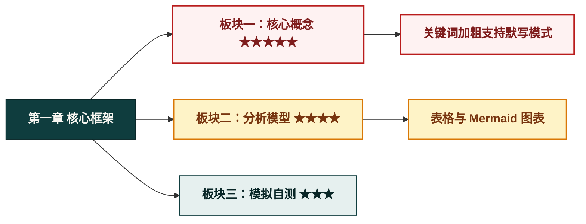
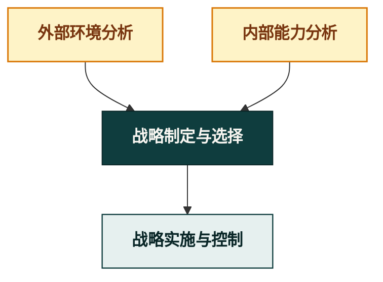

# 📋 核心考点总览

## 全章知识框架导图

> **考情提示**：本文件演示如何仅通过编写标准 Markdown 生成全套复习网页。点击右上角 **`🧠 默写模式`** 可对所有加粗关键词打模糊滤镜，单击任意一处单独显示。

# 🌐 核心概念板块

## 考点一：层级与文字记忆样式 ★★★★★

### 1. 有序列表（自动渲染彩色圆形序号）

1. **核心定义**：使用 `**加粗**` 标注必背关键词，开启默写模式时自动模糊，*斜体文字* 会渲染为暖金衬线强调样式。
2. **重要程度**：在二级标题 `##` 末尾加上 `★★★★★`、`★★★★`、`★★★` 或 `★★`，自动生成对应色条、星级徽章与筛选属性。
3. **公式与代码**：行内公式如 $V = P \times Q \Longleftrightarrow \text{价值创造}$，行内代码如 `unit/1.md`。

### 2. 无序列表（自动渲染箭头与嵌套圆点）

- **一级要点**：使用金/红三角箭头引导视线。
  - 嵌套细节：次级说明自动缩进并切换为深青圆点。
  - 案例举证：*如格兰仕、携程、美的等经典企业案例*。

> **术语对照**：新教材称“低成本定位”，传统表述称“成本领先战略”，两者等价。

> **易错避坑**：包含“易错 / 避坑 / 注意 / 陷阱”的引用块会自动变为琥珀色警示框。

# 📊 模型与表格对比

## 考点二：模型对比表与内嵌图表 ★★★★

| 维度 | 方案 A | 方案 B | 适用条件 |
| :--- | :--- | :--- | :--- |
| **核心优势** | **低成本规模效应** | **独特产品差异化** | 视行业结构而定 |
| **主要风险** | 易受原材料波动冲击 | 研发与营销成本过高 | 需动态评估 |

### 内嵌流程图示例

# ✏️ 模拟自测题

## 一、单项选择题

:::qa [单选题 1]
在 Markdown 模板中，哪一级标题会自动切分为顶部的平行栏目（Tab）？（ ）

- A. 一级标题 `#`
- B. 二级标题 `##`
- C. 三级标题 `###`
- D. 四级标题 `####`
---
**参考答案：A**。一级标题 `#` 自动生成平行分栏；二级标题 `##` 生成星级卡片大标题；三级 `###` 生成小节标题。
:::

## 二、简答题

:::qa [简答题 1 · 10分]
**简述本复习模板支持哪些核心学习交互功能？**
---
1. **平行板块切换**：按一级标题自动分栏，避免单页过长。
2. **星级筛选**：支持一键筛选 `★★★★+` 与 `★★★★★` 必考核心。
3. **默写模式**：一键模糊所有加粗关键词，单击某处独立显示核对。
4. **单题独立答案切换**：每道自测题配有独立按钮显示/收起答案与采分点。
:::
